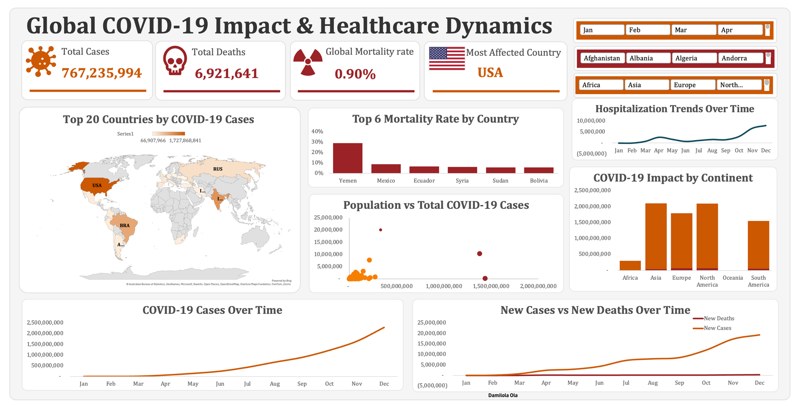

# Global COVID-19 Impact & Healthcare Dynamics

An interactive data analytics dashboard analysing the global impact of COVID-19, with a focus on cases, deaths, mortality rates, geographic distribution, hospitalization trends, and differences across countries and continents. Built as part of my data analytics training with Vephla.

## Objectives

- Analyse the global distribution of COVID-19 cases and deaths
- Compare COVID-19 impact across countries and continents
- Identify countries with higher mortality rates
- Examine COVID-19 and hospitalization trends over time
- Explore the relationship between population and reported COVID-19 cases
- Present key findings through an interactive dashboard

## Tools

- Microsoft Excel – data cleaning, analysis, pivot tables, and dashboard development
- Data visualisation – charts, maps, trend analysis, and interactive filters

## Dashboard Features

- Global COVID-19 cases and deaths overview
- Global mortality rate
- Most affected country
- Top 20 countries by COVID-19 cases
- Top countries by mortality rate
- Population vs. total COVID-19 cases
- Hospitalization trends over time
- COVID-19 impact by continent
- COVID-19 cases over time
- New cases vs. new deaths over time
- Interactive filters for month, country, and continent

## Key Metrics

| Metric | Value |
|---|---:|
| Total Cases | 767,235,994 |
| Total Deaths | 6,921,641 |
| Global Mortality Rate | 0.90% |
| Most Affected Country | USA |

## Key Insights

1. The United States recorded the highest number of reported COVID-19 cases within the dashboard's dataset.
2. COVID-19 cases increased substantially over the period analysed, with the highest cumulative levels occurring toward the end of the year.
3. Mortality rates varied considerably across countries, with Yemen recording the highest mortality rate among the countries displayed.
4. Asia and North America recorded the highest overall COVID-19 impact among the continents shown.
5. Hospitalization levels increased significantly toward the later months of the period analysed.
6. The comparison between population and total cases shows substantial variation in COVID-19 impact across countries.
7. New COVID-19 cases increased significantly over time, while new deaths remained comparatively lower in the later months shown.

## Recommendations

- Monitor countries and regions experiencing rapidly increasing case or hospitalization trends.
- Use mortality-rate comparisons to identify locations requiring closer health-system monitoring.
- Analyse population-adjusted measures alongside absolute case counts when comparing countries.
- Monitor emerging trends over time to support timely healthcare resource planning.
- Use interactive filtering to investigate country- and region-specific patterns in greater detail.

Author

Ogundiran Damilola
